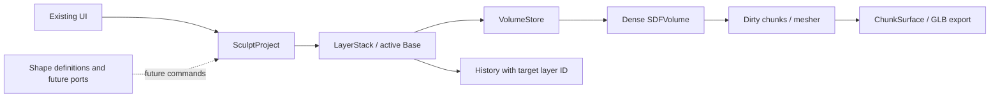

## Move precision — Phase 2.5

Quest polish controls: **Snap 15°** in the Tool Wheel/Options shares snapping between Straight Line direction and Move rotation. Tool stick resizes Clay while drawing; during an Elastic grab it adjusts **edge softness** (up softer, down firmer), preserving captured radius/pivot. Fresh defaults use Support trigger for opposite Clay Add/Subtract; existing saved alternate preferences are preserved. Mirror's red border/centre handle can be dragged in VR to set its layer-local offset. In Layers, **Merge with…** selects a second source, resolution and confirmation; Union creates a new editable layer and hides the two originals, with one Undo. Desktop **Bake / Merge layers… → Sources** offers the same pair merge. Continuous Stamp shows up to 16 lightweight pending-shape previews while exact final work advances over frames; allow the queue to finish after release. [Headset feedback and retest checklist](docs/PHASE_3_HEADSET_FEEDBACK.md).


In VR Move Options, **Precision** reduces hand/wrist sensitivity to one quarter. Translate, Rotate region and Twist region use the captured grip pose and fixed surface pivot; small tracking movements are suppressed. Three subtle influence rings and a point show the target, amber when locked. Support-trigger temporary Smooth now returns to Move with its settings intact. Release holds the preview while reconstruction completes, then commits one Undo action.

Software/browser validation is complete; physical Quest 3 acceptance is pending. See [design, actual measurements and headset checklist](docs/VR_MOVE_PRECISION.md).

## Efficient test runs

Use `npm test -- move-worker` for a focused file, `npm run test:changed` for affected tests, and `npm test` for the full suite. Compilation is cached automatically. See [testing commands and validation policy](docs/TESTING.md).

## VR polish and performance — Phase 1.12d

The direct Support-grip wrist grab is preserved. New subtle grip/release/tracking feedback, contextual realistic-mode rays and **Reset Workspace View** improve navigation. Reset restores the first tracked entry view without changing layers, voxels, saves or exports.

Use the debug card footer **Models | Hints | Reset | Performance**, or mirrored XR controls. Performance is off by default and reports callback timing/spikes, draw/triangle submissions, active resolution and visible source/composite mesh counts at 2 Hz; it is not a GPU timer. Static help/debug textures now update only when content changes.

See [current guide and actual Phase 1.13a architecture findings](docs/VR_POLISH.md). Build and **244 tests** pass. Prior hardware grab/model behavior is user-confirmed; new D changes still need physical Quest verification. No two-handed or independent layer manipulation was added.

## Workspace grabbing — Phase 1.12c

In VR, hold the **Support Hand grip** (left by default), move/rotate the sculpture, then release to leave it there. This changes only XR workspace presentation; layers, voxels, history, saves and GLB coordinates stay unchanged. Exit restores the desktop and re-entry starts from a fresh fit.

The debug card now cycles **Realistic / Simple / Minimal** controller visuals and **Hidden / On demand / Always** hints. Realistic models load asynchronously with indicator fallback. See [VR workspace guide and physical checklist](docs/VR_WORKSPACE.md). Build and 232 tests pass; new Phase 1.12c physical verification is pending. No VR layer grabbing, sculpting, stamping, two-hand manipulation or locomotion is added.

## Quest controllers — Phase 1.12b

Both Touch Plus controllers now have tracked grip indicators and pointing rays. Enter VR to see the debug card beside the sculpture. Point either ray and tap its trigger on **Swap Tool / Support** or **Hide/Show diagnostics**. Physical left/right colours stay cyan/amber. The mirrored **VR / WEBXR DIAGNOSTICS** controls also work during VR.

Inputs are diagnostic only: no sculpting, grabbing, stamping, locomotion or layer changes. Build and 216 tests pass; new controller hardware verification is pending. See [controller setup, mappings and physical verification checklist](docs/VR_CONTROLLERS.md). Previous Phase 1.12a headset success is recorded separately.

## PCVR rendering foundation — Phase 1.12a

The existing WebXR renderer now has device-neutral availability/session diagnostics and a configurable neutral grey VR background. Exiting restores the desktop background and editor. Controller tracking remains the next phase.

See [PCVR testing instructions](docs/PCVR_WEBXR.md) for same-PC localhost, Mac-hosted trusted HTTPS or authorized SSH forwarding, runtime/browser checks and the headset acceptance checklist. Start with `npm run dev`; open `http://localhost:5173/` on the PC actually running the server and compatible VR browser. HTTP LAN addresses require a secure-origin alternative for XR. Previous Quest hardware success is user-reported; physical PCVR testing remains pending.

## Quest 3 / WebXR foundation — Phase 1.12a

Use **Enter VR** to view the existing sculpture in a supported secure-context WebXR browser. Desktop editing pauses during VR and resumes on exit. Controller editing/manipulation is deferred.

See [docs/QUEST_WEBXR.md](docs/QUEST_WEBXR.md) for exact Quest USB localhost, LAN HTTPS, trust, emulator and testing instructions. Start desktop with `npm run dev` (5173); configured HTTPS uses `npm run dev:https` (5174). HTTP `.local` works for desktop LAN testing but does not qualify for WebXR. No physical Quest verification has been performed yet.

## Current rendering modes — I

The cycle is **Normal → Matte → Glossy → Normal**, using the viewport button, the Layers selector or **I**. Wireframe has been removed. Normal and Glossy retain their previous appearance; Matte adds softer, broader reflections between them. I ignores text/numeric editing, modifiers, held-key repeats and busy/modal operations. Old Wireframe project preferences migrate to Normal; sculpture data and neutral GLB exports remain unchanged.

## Viewport rendering styles

Use the **◐ Normal / Matte / Glossy** button at the lower-right of the viewport or press **I** to cycle styles, or choose **Rendering style** in the Layers panel.

- **Normal:** the existing neutral clay rendering.
- **Glossy:** low-roughness material with cached studio reflections and tone mapping, useful for seeing bumps and smoothness while orbiting.
- **Matte:** softer, broader reflections between Normal and Glossy.

Styles combine with Clay/Layer Colours and apply to separate layers and the Boolean Preview. They do not resample voxels, regenerate meshes or create undo actions. The selected style is saved as an optional native display preference; older projects default to Normal. Both GLB exports keep their original neutral solid materials. The studio environment is generated once on first Matte/Glossy use and reused; GPU/frame performance has not been benchmarked.

## Manual stamp placement defaults to Move

Turning **Follow pointer on visible surfaces** off now automatically shows Move handles. Drag an arrow/plane to position the preview, then use **Apply stamp** directly—there is no need to finish Move first. Clicking or dragging on the viewport while Move is active cannot stamp accidentally. Apply is disabled only during an active drag, rotation, a busy operation, or an unavailable target. **T** switches to rotation; finishing rotation returns to Move. **G** optionally hides/shows the move handles. Re-enabling Follow pointer hides both gizmos and restores surface placement.

## Move a held stamp preview — G

With **Follow pointer on visible surfaces** off, press **G** or use **Move preview (G)** in the panel / **Move G** in the viewport. Drag a coloured axis arrow or plane handle to position the ghost freely. Press G again to finish, then **Apply stamp**. **T** switches to rotation; G switches back to movement. Both modes affect only the ghost and pause stamping while active. The held position remains until you re-enable surface following. XYZ fields still work for precise placement; Add stamps must fit within the target layer's existing bounds.

## Rotate a stamp ghost — T

With a Boolean shape preview enabled, press **T**, or use **Rotate stamp (T)** in the Shape Library / **Rotate T** in the viewport toolbar. Pointer following turns off so the ghost stays put. Drag a coloured rotation ring; camera orbiting is paused during the drag and stamps are disabled throughout rotation mode. Press **T** again to finish, then click or use **Apply stamp**. The pose stays fixed until you explicitly re-enable Follow pointer. Numeric angles remain editable. The pose-space selector chooses world versus local axes (local gizmo rings align to the ghost). B returns to brushes. T is ignored while typing in fields or during busy/modal operations.

Rotation changes only the session ghost: no layer transform, voxel resampling, source remeshing or undo action until you explicitly stamp. Existing project files and both exports exclude the ghost/proxy/gizmo.

# Centra Sculpt

Centra Sculpt is the current name of this independent SDF sculpting app. Existing `.form` native projects and the internal file signature remain compatible.

Two circular viewport controls keep the main tools close to the sculpture. **Sculpt tools** opens Brush / Boolean / Smooth; Boolean opens the procedural shape stamping panel (separate from the layer Boolean Preview display). **Layer transforms** opens Move / Rotate / Scale for the selected visible, unlocked layer. Choosing a layer tool exits shape mode; choosing Brush hides the ghost. Smooth activates the smoothing brush; Brush/B restores the last Add/Subtract choice. B returns to Brush, and W/E/R retain their layer tool shortcuts. Wheels support touch/click, arrow keys, Enter/Space and Escape. Only one wheel opens at a time; menus never edit sculpture data themselves.

The refreshed shell uses Centra Sculpt branding, clearer studio panels, a compact header and contrasting circular overlay menus. Layer CSG, Bake, project colours/save/load, GLB export and all sculpting workflows remain available. Export filenames now use `centra-sculpt.glb` / `centra-boolean-result.glb`; native extension stays `.form`.

## LAN testing and brush shortcut

Run `npm run dev` on this Mac. From a phone on the same LAN, open **http://bretts-macbook-pro.local:5173/**. The Vite configuration listens on all interfaces and explicitly allows that hostname. If the phone cannot resolve `.local`, use the Mac's current LAN IP address with port 5173 instead. If macOS requests firewall access for Node, allow incoming connections for LAN testing.

Press **B** to return to the current Add/Subtract/Smooth brush, hiding the shape ghost and leaving layer transform mode. B is ignored while typing in text/numeric fields or while a modal/project operation is busy. Selecting **Sculpt (B)** also returns from the ghost to brushes.

# Phase 1.11 update — Interactive Shape Stamping

Open **Shape Library**, choose Sphere, Cube/Box, Triangular Prism or Square Pyramid, and select Add/Subtract. Adjust dimensions, rotation and uniform scale; move the pointer over a visible sculpture surface and **left-click once**. A drag never repeats stamping. Shape orientation/size remain between stamps. For numeric placement, disable **Follow pointer on visible surfaces** (editing position also disables it), then use **Stamp once at preview**. The shape centre follows the surface hit; it is not automatically normal-aligned. Hide ghost / Escape restores brushes and layer gizmos; right/middle/wheel camera controls still work.

One stamp is one exact layer-aware undo action (Cmd/Ctrl+Z; Shift to redo). Only the active visible unlocked layer is edited; layer operation/order/transforms and other SDF volumes remain independent. Actual voxel CSG uses min/max, without smoothing or resampling. Add must fit inside the fixed volume with a one-voxel safety margin; out-of-bounds shapes are rejected clearly. Subtract may overlap the bounds within supported distance limits. Tiny details remain limited by target voxel spacing. Native v3 saves stamped data and chosen layer colours/mode, with legacy compatibility. Ghosts are temporary and never saved/exported. Both GLB workflows remain neutral.

Validation: `npm run build` passed; **167/167 tests passed**. CPU stamp totals for the benchmark shapes: **27–42 / 75–168 / 177–582 ms** at 64³/128³/192³. Chunk-local remeshing remains intact. Exact CSG far-field values may require full dense candidate scans and large sparse history actions; high-resolution stamping can briefly block the main thread. No workers, continuous stamping, VR or deformation tools were introduced.

Run `npm run dev` and open http://localhost:5173. Run `npm test`, `npm run build`, `npm run benchmark:stamps`. See `docs/DEVELOPMENT_STATUS.md` for the current handover and Phase 1.12 recommendations. Earlier phase notes below are retained as historical context.

# Form — Phase 1.10 procedural SDF Shape Library

A desktop browser sculpting prototype built with Vite, TypeScript and Three.js. Current behavior is Phase 1.10; earlier phase sections below document their historical baselines.

## Run

```sh
npm install
npm run dev
```

Open the localhost URL printed by Vite (normally http://localhost:5173).

```sh
npm run build
npm run preview
```

`build` runs strict TypeScript checking and creates the production bundle in `dist/`.

## Controls

- Shape Library: select Sphere, Cube/Box, Triangular Prism or Square Pyramid. Adjust dimensions and local/world ghost pose; teal Add and rust Subtract are preview-only. Ghost enabled pauses brushing/layer gizmos; hide it or press Escape to resume. Camera controls still work. Ghosts never enter native files, Boolean composition, Bake or GLB. Applying shapes is deferred to Phase 1.11.
- Bake / Merge visible layers: confirm a result name, exact 64³/128³/192³ output resolution, padded world bounds and approximate memory. Sources are preserved and hidden by default; keeping them visible switches to Separate Layers. Cancel is available before and during the operation. The entire Bake is one undoable action.
- Layers panel: create a new independent sphere at 64³/128³/192³, select, rename, copy, confirm deletion, reorder, hide/show and lock/unlock. At least one layer is retained.
- Surface View: Separate Layers shows independent sources; Boolean Preview evaluates visible layers top to bottom. The first visible layer initializes the result; subsequent Add/Union, Subtract and Intersect selectors combine into a derived field. Operations and reorder arrows are undoable.
- Layer display colours: Clay uses neutral materials; Layer Colours uses per-ID, session-only colour preferences. Source voxel data is never implicitly merged.
- Left drag on the sphere: sculpt with the selected Add, Subtract, or Smooth brush. Hold still to keep applying the brush.
- Move (W), Rotate (E), Scale (R): transform the selected visible, unlocked layer. Choose World/Local gizmo axes; every scale handle applies uniform scaling. Choose Sculpt to resume brushing. Gizmo dragging excludes camera/sculpt input.
- Numeric transform fields: position in project units, Euler XYZ rotation in degrees, positive uniform scale. Reset Transform is undoable. Shortcuts leave editable fields alone.
- Right drag: orbit. Middle drag: pan. Scroll: zoom.
- Brush radius slider: change the area affected (0.12–0.50 world units).
- Brush hardness slider: independent core/shoulder falloff control for Add/Subtract; 0% retains soft clay, 100% gives a broad core with a sharp but continuous edge. Smooth ignores hardness.
- Voxel resolution: select 64³ (default), 128³ or 192³ and click Resample. The local bounds and scalar field are interpolated; only that layer’s voxel history is cleared. Transform actions remain valid. Downsampling loses fine detail.
- Brush strength slider: control displacement or smoothing rate (1–100%). Green, rust, and blue brush rings identify Add, Subtract, and Smooth; opacity reflects strength.
- Undo / Redo: one continuous left-button stroke is one history action, including stationary holds and Smooth. Use Cmd/Ctrl+Z and Cmd/Ctrl+Shift+Z.
- Save Project / Open Project: download or restore an editable `.form` project.
- Reset sphere: restore the initial sphere as an undoable action.
- Export Separate Layers: download visible source nodes with their transforms in `form-sculpture.glb`. Export Boolean Result: evaluate the current quality-capped composite and download one world-space mesh in `form-boolean-result.glb`. Both use neutral clay materials, preserve all sources and work from either surface view.

## Modules

- `src/bake.ts`: validated bake plans, bounds/memory estimates and cooperative world-space sampling into a new editable volume.
- `src/compositor.ts`: ordered world-space SDF evaluation and a disposable, cooperatively rebuilt derived-grid/chunk cache.
- `src/independent-layers.ts`: per-layer runtime ownership, active editing, project-wide history timeline, independent resampling and separate-node GLB export.
- `src/display-preferences.ts`: viewport mode/colours keyed by project/layer IDs, saved as optional native-project display preferences.
- `src/volume-store.ts`: storage/sampling/region contract, with an optional borrowed dense view for hot loops.
- `src/transform.ts`: local/world transform conventions, uniform scale validation and metadata helpers.
- `src/transform-tools.ts`: Three.js gizmo integration, uniform scale handles and gesture transactions.
- `src/interaction.ts`: exclusive camera/sculpt/transform input ownership.
- `src/layers.ts`: stable layer/project IDs, layer metadata, active selection, ordering and edit guards.
- `src/shapes.ts`: validated shape definitions and future preview/stamp/controller input contracts; no geometry edits or UI.
- `src/sdf.ts`: 64³ scalar samples by default, initial sphere, compact smooth Add/Subtract displacement, and snapshot-based six-neighbor Smooth relaxation. Negative values denote the interior. Smooth uses a convex blend and never reads partially updated neighbors; boundary samples stay unchanged.
- `src/stroke.ts`: elapsed-time integration into bounded substeps (at most 1/120 second), with motion resampling at 20% of brush radius. Resampling divides total strength between dabs. Long frame gaps are capped to prevent abrupt jumps.
- `src/mesh.ts`: marching tetrahedra with outward winding and interpolated central-difference SDF gradient normals. Cached 16³-cell chunks re-extract only edited areas plus a normal-gradient halo. The renderer uses separate chunk meshes and retains untouched geometry buffers. A full extraction remains available for correctness comparisons.
- `src/ui.ts` and `src/style.css`: toolbar, controls, status and layout.
- `src/surface.ts`: chunk mesh rendering, local buffer replacement, and merging visible chunks for GLB export.
- `src/resolution.ts`: bounded dense-grid trilinear resampling and resolution limits.
- `src/history.ts`: sparse per-stroke Float32 voxel deltas with exact undo/redo and bounded history.
- `src/project.ts`: v3 layer-ready native serialization, v1/v2 migration and validation. The old single-volume writer remains an explicit compatibility API.
- `src/main.ts`: Three.js scene, orbit controls, raycast brush placement, dirty mesh scheduling (at most 30 updates/second), timings and binary glTF export. Releasing a stroke or exporting flushes pending changes. Idle frames skip meshing.

The editable volume extends from −1.6 to +1.6 on each axis. Positive boundary samples keep the extracted surface closed. This fixed-resolution prototype uses smooth gradient normals; fine detail is limited by its approximately 0.051-unit default voxel spacing. Brushes move the zero level set; the scalar field is not reinitialized to exact Euclidean distance after each stroke. Removing all visible material requires Reset to begin again. Headset/WebXR input is outside this phase.

Dependencies are installed locally. Google Fonts are optional; the app falls back to system fonts offline.


## Phase 1.2 validation

```sh
npm test
npm run build
```

No additional dependencies were needed for Phase 1.2. The test launcher uses the existing TypeScript compiler and Node's built-in test runner, writing intermediate modules to ignored `work/test-build/`.

The automated tests cover radial falloff/locality, Add/Subtract direction, reset, invalid inputs, strength proportionality, stationary frame-rate consistency, moving stroke spacing, snapshot filtering, repeated Smooth stability, boundary preservation, gradient normals, and incremental/full extraction equivalence across chunk boundaries. A default-resolution benchmark prints initial and local rebuild times. These timings cover CPU extraction, normal generation, buffer assembly and bounds calculation; they exclude GPU uploads and rendering. The viewport shows last/average rebuild duration and changed/total chunks. Timing results vary by machine and brush size.

For a manual check, start `npm run dev` and hold or drag on the sphere with each brush. Try low strength for gradual clay changes, create a bump or dent, then brush over it with Smooth. Increase radius and observe the ring size and number of updated chunks. Right-drag to orbit, middle-drag to pan and scroll to zoom. Export the sculpted GLB, then Reset to restore the sphere. Export retains smooth normals and flushes pending edits.

Local edits upload only dirty chunk geometry. Full-volume extraction is avoided during typical strokes, but chunk extraction remains synchronous on the main thread. Smooth is a diffusion filter and can shrink features; it is not volume-preserving. The field is bounded for numerical stability and is not redistanced after each stroke.


## Phase 1.3 history and projects

History records a voxel's original value only on its first change during a stroke, updating its final value on subsequent dabs. On pointer release, cancellation, loss of capture or focus, the action becomes packed `Uint32Array` indices and Float32 before/after arrays. No full-volume snapshot is taken on pointer movement. Empty strokes preserve redo; a new nonempty action clears redo. Undo/Redo flush any active stroke first, and invalidate only affected mesh chunks. Reset is also recorded as one action. Keyboard shortcuts leave text/file inputs alone.

Save Project downloads `sculpture.form`. Open Project validates a selected local file and prepares its mesh before replacing the current project. A failed import preserves the sculpture, settings and existing history. A successful import starts a new history. GLB export remains separate: it exports the rendered mesh and material, and cannot be opened as an editable native project.

The native **`.form` version 2** (version 1 remains readable) format contains:

| Byte offset | Data |
| --- | --- |
| 0 | Eight-byte magic `FORMSDF` followed by a zero byte |
| 8 | Version number, unsigned 32-bit little-endian (`2`) |
| 12 | Metadata byte length, unsigned 32-bit little-endian |
| 16 | UTF-8 JSON: cubic grid dimensions, world extent, `float32-le` encoding, brush mode/radius/strength/hardness, camera position/target |
| After metadata | Exactly `resolution³` Float32 little-endian SDF samples, x fastest, then y, then z |

Validation rejects unsupported versions/encodings, malformed metadata, wrong payload lengths, invalid grid/settings/camera values, non-finite or out-of-range samples, and nonpositive boundary samples. File size is capped before reading. A topology count also rejects excessive surface complexity before allocating geometry. All error messages are displayed as text.

### Limits

- Supported project grids are cubic, from 3³ through 192³ samples; extent must be greater than 0.85 and at most 10 world units per half-axis. Non-cubic grids require a future format/runtime extension.
- Projects are limited to 1,000,000 extracted triangles and a maximum file size of approximately 27.1 MiB. This protects the synchronous CPU mesher from pathological input fields.
- History is session-only and is not included in saved projects. It retains at most 100 actions with a 32 MiB soft payload budget. The newest action is always retained even if it alone exceeds that budget. The temporary sparse recording map and normal JavaScript overhead are additional memory.
- Opening a project intentionally starts fresh history. Saving uses a browser download; there is no autosave or direct overwrite of the source file.
- Only the current fixed material and rendering defaults are used. Brush settings and camera pose are saved; UI layout and history are not.

### Check Phase 1.3

Run `npm test` and `npm run build`. Tests cover multi-dab stroke grouping, exact Add/Subtract/Smooth undo and redo, redo invalidation, empty/net-zero actions, undoable reset, history eviction, native project round trips across multiple grid sizes, Float32 saturation, malformed/future/oversized files, invalid settings and voxels, and surface complexity limits. Existing sculpting and meshing tests remain in place.

For a manual check: sculpt continuously, release, and verify Undo removes the whole stroke. Redo it using both the buttons and keyboard shortcuts. Undo again, make a different stroke, and verify Redo becomes unavailable. Save a project, change the sculpture and brush settings, then reopen the saved file: the original surface, grid, settings and camera should return. Try opening a malformed file and verify the current sculpture remains. Export a GLB independently.


## Phase 1.4 chunk rendering and resolution

The dense SDF remains the single source of truth. Every chunk owns a disjoint range of cells and reads shared global samples. Marching tetrahedra uses the same cube diagonal on both sides of a seam. Normals interpolate central differences from that same global field. An edited sample at index k can affect surface cells from k−2 through k+1 because of normal interpolation, so invalidation includes that halo. Dirty chunks are stored as a set; separate edit areas do not create a large bounding box across unrelated chunks. Each resampled brush dab marks its affected chunks.

`rebuildChunks()` returns only changed geometries. `ChunkSurface` replaces only those chunk mesh attributes, removes empty chunks, and keeps untouched geometry by identity. The old `rebuild()` combined-geometry path remains available for reference tests, but the renderer never uses it. GLB export flushes edits and flattens all visible chunks, with transformed positions and smooth normals, into one exported mesh. Brush radius/strength, Smooth, history, reset, project loading and camera controls continue to work with chunk surfaces.

Resolution is **samples per axis** (64 samples imply 63 cells). Resampling retains the same world extent and interpolates the edited field, rather than resetting to a sphere. It starts fresh history because voxel indices and values change. Upsampling cannot reconstruct details lost at an earlier resolution. A failed conversion keeps the old project. Project v2 saves hardness and supports grids up to 192³; v1 files load with hardness 0, preserving their prior soft brush behavior. Older app versions cannot read v2 files.

### Performance and reproducible benchmarks

```sh
npm run benchmark
```

This compiles the core modules and writes `outputs/phase-1-4-benchmarks.json`. The viewport shows last/average brush time, last mesh time and dirty/total chunk counts. Brush time includes integration, falloff/filtering, sparse history recording and dirty-chunk marking. Mesh time includes chunk extraction, normals, CPU buffer creation, old-buffer disposal and bounds calculation. Neither measurement includes raycasting, GPU upload, rendering, history commit, or browser UI work.

One local run on this machine (Node v26.8.1; 16³-cell chunks; radius 0.22, strength 0.35, hardness 0.5; stationary pole stroke with dt 1/60):

| Samples | Initial full mesh | Local mesh median | Add median | Smooth median | Dirty / total chunks | SDF + scratch |
| --- | --- | --- | --- | --- | --- | --- |
| 64³ | 75.3 ms | 15.3 ms | 0.10 ms | 0.09 ms | 8 / 64 | 2 MiB |
| 128³ | 252.2 ms | 11.6 ms | 0.45 ms | 0.42 ms | 8 / 512 | 16 MiB |
| 192³ | 710.3 ms | 12.6 ms | 1.56 ms | 1.56 ms | 12 / 1728 | 54 MiB |

These are CPU measurements, not frame-rate guarantees. Full meshing is cold per resolution; local times are warm medians and depend strongly on brush location, surface complexity and chunk occupancy. Local times need not increase monotonically with resolution because different chunks intersect the surface. Resampling from 64³ took approximately 13 / 66 / 213 ms for 64³ / 128³ / 192³ respectively in that run.

### Tests and remaining limits

`npm test` includes watertight welded edge incidence, matching normals at shared chunk vertices, seam edits on both sides, untouched buffer identity, disjoint dirty areas, undo/redo remeshing, native project and 128³/192³ round trips, resampling, hardness/Smooth independence, legacy v1 migration, and binary GLB accessor/vertex counts. `npm run build` checks TypeScript and creates the production bundle.

Meshing, resampling, validation and saving remain synchronous CPU work. Initial builds and resolution changes may pause the UI, especially at 192³. Dense SDF + scratch storage alone uses 54 MiB at 192³; mesh CPU/GPU buffers, old/new grids during conversion, export buffers and history add to that. More chunks also mean more draw calls. No sparse octree or GPU compute is used. There is no memory-pressure auto-detection or automatic resolution downgrade. History remains session-only, with the existing 100-action / 32 MiB soft payload limit; one active stroke's recording map can temporarily use more memory. Fine hardness features remain limited by voxel spacing. Native saving/importing rejects surfaces over one million triangles; ordinary sculpting does not enforce that cap during every dab.


## Phase 1.5 — layer-ready architecture and shape definitions

The visible interface remains unchanged, including its Phase 1.4 header. The application now owns one `SculptProject` with one `SdfLayer` named Base inside a `LayerStack`. The Base has a stable ID, its own `VolumeStore`, independent dimensions and voxel spacing, name, Euler XYZ transform, visibility/lock flags, Boolean operation metadata and order. Brushes, reset and resampling address the active layer; hidden or locked targets reject edits. Boolean operation metadata is stored but is not evaluated by a compositor.



### Volume contract

`VolumeStore` provides layer-local/world sampling, dimensions, local physical voxel size, local/world bounds, brush editing and dirty bounds, validated region copy/read/write, normal sampling and low-level history replay access. The existing `SDFVolume` implements it without changing brush mathematics. `getDenseView()` is a borrowed fast path for trusted read-only consumers; generic stores may return undefined. Meshing and resampling then use voxel or region access. Region writes validate all values before mutation, preserve the positive boundary and support the same sparse history callback as brushes. Low-level `writeVoxel` is for trusted replay, not unvalidated external input.

Transforms are translation plus Euler XYZ rotation in radians plus positive XYZ scale. World sampling converts into local coordinates and scales the scalar field by the minimum axis scale. That is exact distance scaling for uniform transforms and conservative for nonuniform transforms. Sampling outside the local bounds clamps to the boundary and adds the outside distance; the edited scalar field itself is not guaranteed to remain an exact Euclidean SDF.

### Layer-ready native format

The Save Project button now writes `.form` **version 3**. It uses the existing 16-byte magic/version/metadata-length envelope followed by UTF-8 JSON metadata and packed Float32 LE payloads. Metadata includes project ID/name, active layer ID, sculpting settings/camera and layer records. Every layer record includes its ID/name/order/flags/operation/transform, dimensions/extent/derived voxel size, sample offset and sample count. Validation rejects inconsistent spacing, duplicate IDs/orders, invalid selection or transforms, overlapping/gapped payloads, invalid values and excess resource use.

Version 1 and 2 files migrate losslessly to a Base layer. Version 1 hardness defaults to zero; version 2 hardness is preserved. Legacy layers use a project-scoped `base` ID; project IDs are generated because older files did not contain them. Once saved in v3, both IDs persist. The compatibility `saveProject(volume, settings)` function still writes v2 for existing integrations/tests; new application code uses `saveSculptProject(project)`. `openProject` remains a compatibility reader that also returns the full model; `openSculptProject` is the model-first API.

The codec can round-trip up to eight data-only layer records within the existing aggregate sample/file/triangle budget. **The Phase 1.5 application accepts only one layer**, and explicitly rejects multi-layer files before replacing the current sculpture or allocating render meshes. There is no multi-layer display/editing UI or Boolean compositor. This separates future data evolution from unsupported application behavior.

History transactions retain target layer ID and action kind, with exact sparse before/after values. Replay remains bound to its original volume and respects visibility/locking guards. Reset is tagged as a reset action. Resampling retains Base metadata and ID while replacing its volume and starting fresh history. Project loading still starts fresh history. This phase does not provide global structural-layer history or persist undo stacks.

### Shape foundation only

`shapes.ts` defines sphere, box (including a cube), triangular-prism and pyramid records with stable definition ID, target layer ID, Add/Subtract operation, full local dimensions and a transform. Definitions and transforms are copied and validated. `ShapeKernel`, `ShapePreviewPort`, `ShapeStampIntent` and `ShapeToolInput` are extension contracts only. Preview/commit/cancel intents and normalized analogue scale events are validated without reading a controller or writing any voxels. A future shape stamp can use the existing layer-targeted `shape-stamp` history kind.

Shape transforms are relative to the target layer; a future controller adapter must convert world poses into that layer's local space. Conventions: sphere dimensions contain equal diameters; nonuniform scaling can represent a future ellipsoid. Box dimensions are full XYZ extents. A prism has its triangular cross-section in XY and extrusion along Z. A pyramid has its rectangular base in XZ and height along Y. Origins are bounding-box centers. No kernels, stamping, shape picker, live previews, controller adapters, WebXR, octrees or GPU compute were added.

### Protection, validation and benchmarks

Git initialization was blocked by workspace filesystem permissions. A source checkpoint was created before modifications, with a SHA-256 checksum: `outputs/phase-1-4-before-1-5.tar.gz` and its `.sha256` file. The source, scripts, tests and existing deliverables were protected; dependencies/build caches are excluded. Extract it into a separate empty directory to inspect or recover the earlier project.

`npm run build` passes. `npm test` passes **47 tests**, retaining all 32 existing tests and adding volume-contract equivalence, transformed sampling, region validation, generic-store fallback, layer metadata/IDs/selection/order/guards, layer-aware history, migration, v3 round trips at all supported UI resolutions, malformed metadata and shape/input definition validation. Golden Float32 SHA-256 field fixtures were generated from the protected Phase 1.4 source, so brush equivalence is checked against the earlier implementation rather than only comparing two current code paths.

`npm run benchmark` now writes `outputs/phase-1-5-benchmarks.json`, preserving the Phase 1.4 report. Latest local remeshing medians were 15.3 / 11.8 / 12.7 ms at 64³ / 128³ / 192³, compared with 15.3 / 11.6 / 12.6 ms previously (0–1.7% higher in this sample). Dense resampling borrows a single view outside the inner loop; latest conversions to 128³/192³ were 68 / 217 ms versus 66 / 213 ms in the old report. Cold full builds were 79 / 279 / 751 ms, around 5–11% higher in this single sample. These measurements exclude GPU rendering and are not controlled frame-rate guarantees. The detailed implementation and validation report is `outputs/phase-1-5-report.md`.

All earlier dense-grid/CPU/memory limits still apply. Only uniform cubic grids are implemented by the dense backend, although layers may have different resolutions and extents. Nonuniform transforms preserve signs and metadata but do not produce exact world-space Euclidean distances; the brush cursor is indicative under nonuniform scale. There are no transform-editing or layer-editing controls in this phase.


## Phase 1.6 — independent sculpting layers (current behavior)

Each layer owns a separate dense SDF, independent resolution/bounds/pose, chunk mesher/render group, material and sparse voxel history. Create, copy, select, rename, reorder, hide/show, lock/unlock and confirmed deletion are available in the Layers panel. New layers start as independent spheres at the origin so the existing surface brushes can immediately edit them. They intentionally overlap; no automatic placement, merge, bake, union, difference or intersection is performed. Layer Boolean metadata remains stored for future non-destructive composition, but is not evaluated.

Copy allocates fresh voxel storage with identical data/resolution/bounds/transform/flags and a new stable ID. Model validation rejects shared volume objects/buffers. Active-layer picking tests only that layer's meshes, even when another layer overlaps or occludes it. Hide other layers when inspecting a surface underneath. Hidden/locked layers cannot be sculpted, reset, resampled or changed by undo/redo until made editable again. Structural management such as rename/copy/delete is allowed without modifying their source voxels.

The resolution selector edits only the active layer. Changing it replaces only that layer's store/runtime and clears only its history. Every other layer's data, resolution, mesh buffers, history, pose and colour preference stay intact. No automatic resolution downgrade or project-wide resampling occurs. A runtime also rejects out-of-band store replacement rather than replaying history into the wrong volume.

### History policy

Undo/Redo follows the chronological stroke/reset order across layers. Every entry identifies its original layer; replay selects that layer and rebuilds only its dirty chunks. It never redirects edits into the current selection. Hidden/locked targets report an error and leave the timeline/data intact; show/unlock the target to replay it. A new nonempty stroke/reset clears redo across all layers. Empty clicks retain redo. One continuous drag remains one action, with existing Cmd/Ctrl+Z and Cmd/Ctrl+Shift+Z shortcuts.

Delete removes the deleted layer's runtime and its own history entries; surviving entries remain valid. Copy creates fresh history for the copy. Resampling invalidates only the resampled layer's entries. Layer creation/deletion/copy, names, ordering, flags and display preferences are **not undoable structural actions** in this phase. Delete therefore asks for confirmation, and the last layer cannot be deleted. History remains session-only, capped at 100 actions / 32 MiB soft payload per layer; the global timeline reconciles payload eviction.

### Viewport colours, persistence and export

Clay mode uses the existing neutral sculpting colour. Layer Colours mode uses independent material clones, with sensible unused palette defaults and a colour input per row. Preferences live in a separate display object keyed by project/layer IDs. Save Project now includes layer colours and Clay/Layer Colours mode in optional native display metadata, restored even in a fresh browser session. They do not alter voxel values, history or layer metadata. Older files remain readable; fresh sessions use default colours/mode when that metadata is absent.

Native `.form` v3 stores **all layers** and their separate Float32 payloads, IDs, names/order, visibility/locks, independent dimensions/voxel spacing/bounds, transforms, active selection and global sculpting settings/camera. Versions 1/2 still migrate into an editable Base. Optional `displayPreferences` stores validated RGB colours by stable layer ID and the display mode. The aggregate voxel allowance is now equivalent to two 192³ volumes (14,155,776 samples), within a maximum of eight layers. This is a total memory policy, not an automatic resampling policy. Larger v3 files may exceed older apps' limits.

GLB export makes **one separate mesh/node per visible nonempty layer**, flattening chunks only within their own layer. Layer names and stable-ID extras are included. Position/rotation/scale are preserved on those independent nodes; transforms are not baked into voxel data. All nodes use the shared neutral material, regardless of viewport colours. Hidden/empty layers are omitted; exporting with no visible surfaces reports an error. Export never evaluates SDF Booleans.

### Transform preparation

Layer render groups apply their existing translation, Euler XYZ rotation and positive scale metadata. Picking occurs in world space; brush centres convert to the target layer's local space. Export retains per-node transforms. There are no movement/rotation/scale gizmos, controller manipulation or transform editing controls. Brush radius remains in layer-local units; uniform scaling is supported consistently. Nonuniform world-distance/cursor precision retains the previous conservative/indicative limitation.

### Validation and performance

Run `npm run build`, `npm test` and `npm run benchmark`. The build passes; **62 tests pass**, retaining the 47 Phase 1.5 tests and adding 15 independent-layer cases. Tests include byte/mesh-buffer independence, active targeting and all brushes, policy guards, chronological cross-layer history, target-only resampling, independent copy storage, safe deletion, colour-free exact serialization, multi-layer/legacy load, unbaked transforms, real GLB mesh/node counts, payload eviction and alias rejection.

Latest CPU local-meshing medians with another inactive 64³ layer present: **16.6 / 10.8 / 11.0 ms** at 64³ / 128³ / 192³. The inactive layer's voxel bytes and mesh buffer identities were verified unchanged. Compared with the Phase 1.5 rows (15.3 / 11.8 / 12.7 ms), the 64³ sample is 1.3 ms higher; higher resolutions were faster in this run. This is not a controlled frame-rate guarantee. GPU rendering/picking, overdraw and draw-call costs are excluded. Detailed results are in `outputs/phase-1-6-benchmarks.json`.

Browser validation created and sculpted layers at different resolutions, switched colours/visibility/locks, renamed/reordered/copied/deleted with confirmation, replayed history across targets, independently resampled a layer, and saved/reloaded an actual 64³/192³ project. Its actual native metadata was checked for absence of viewport preferences, and its downloaded GLB was inspected for two separate named nodes and neutral material. See `outputs/phase-1-6-file-verification.json` and `outputs/phase-1-6-report.md`.

### Limits and project protection

- Maximum eight layers, aggregate voxel budget equal to two 192³ grids, and existing one-million-triangle native save/load limit. Capacity failures keep existing layers rather than merge/downsample them. Hidden layers still occupy memory.
- CPU meshing, resampling, import preparation and export remain synchronous. Multiple high-resolution layers increase memory, draw calls and overdraw. Two 192³ SDF/scratch pairs alone require 108 MiB, plus meshes, GPU buffers, history, temporary imports/resampling and export buffers.
- Coincident/overlapping surfaces are intentionally not composited. A small viewport-only polygon depth bias stabilizes exact ties by order; hide layers to inspect occluded geometry. No geometry/SDF is moved or merged for this display tie-break.
- History covers voxel strokes/reset, not structural management or preferences. Loading a project starts fresh history; no autosave is included.
- No Boolean compositor, Merge/Bake, sparse backend, GPU compute, interactive transform gizmo, shape stamping or VR input was added.
- A verified pre-change archive is available as `outputs/phase-1-5-before-1-6.tar.gz` with SHA-256. Git remains unavailable in this workspace.
- `vite.config.ts` ignores generated work/output/test/script changes so validation tools do not reload an unsaved browser sculpture. Editing application source still causes normal Vite hot reload.


## Phase 1.7 — independent layer transforms

Move, Rotate and uniform Scale update the selected layer's metadata and scene matrices only. They never change voxel bytes, resample volumes, dirty chunks or allocate replacement surface geometry. World/Local controls gizmo axes; position fields remain absolute project coordinates. Internal Euler XYZ angles remain radians, while numeric UI fields show degrees. Scale is positive, from 0.001 to 1000. Layer transforms remain independent, including coincident/overlapping layers.

One completed gizmo drag is one undo action. Each committed numeric change and Reset Transform is also one action. Voxel and transform transactions share a chronological, layer-ID-addressed timeline; replay selects the original layer. Hidden or locked targets reject editing/replay until shown/unlocked. Deletion discards only the deleted layer's actions; resampling clears only its voxel history and retains transform actions. Transform history is capped at 100 actions per layer, separately from existing sparse voxel history limits. Structural layer management and viewport preferences remain outside history. Loading starts fresh session history.

Raycasts hit the active layer's transformed chunk group. World hits are inverse-transformed into layer-local coordinates, and the local brush radius is world radius divided by uniform scale. The brush ring remains in world units. Scene transforms also rotate surface normals correctly. Sculpt, transform and camera gestures have exclusive ownership; OrbitControls updates pause during editing so damping cannot move the camera mid-drag.

Native v3 already supports per-layer transform metadata, so no format bump is required. Versions 1/2 still migrate. GLB keeps one node per visible layer with local geometry and its transform matrix, using the existing neutral clay material rather than viewport colours. Older nonuniform transform metadata is preserved: Move/Rotate still work, but sculpting and Scale require an explicit uniform numeric scale or Reset Transform. This avoids silently deforming or resampling a legacy volume.

Validation: **78 automated tests pass**, including 16 transform tests; `npm run build` passes. Browser checks exercised real Move/Rotate/Scale drags, W/E/R, field-focus shortcut guards, numeric edits, Reset, mixed voxel/transform undo/redo, locks, transformed sculpting, camera zoom recovery, native save/reopen and GLB downloads. A 64³ Base plus transformed 128³ layer round trip preserved both poses. The Base retained all original voxels; only the brushed 128³ layer changed (6,041 voxels). The downloaded GLB had two separate nodes whose matrices matched the native file, and native metadata excluded viewport colours.

`npm run benchmark` now writes `outputs/phase-1-7-benchmarks.json`. Local mesh medians were **14.1 / 13.5 / 11.1 ms** for 64³ / 128³ / 192³, compared with Phase 1.6's 16.6 / 10.8 / 11.0 ms. This run showed a 2.7 ms increase at 128³, a 2.5 ms improvement at 64³ and a 0.1 ms increase at 192³; warm timing noise is not a controlled regression measurement. Mean metadata/scene transform updates over 1,000 iterations were **0.0022 / 0.0026 / 0.0045 ms**, with unchanged voxel bytes and geometry identities, and zero remeshing. CPU timings exclude rendering/GPU, picking and DOM updates.

Limits: uniform positive scaling only; no snapping, hierarchy editing, transform gizmo pivot editing, Merge/Bake, Boolean compositing, deformation Move tool, shape stamping or VR input. Very large scales can make a world brush smaller than a voxel, and extreme transforms may exceed existing camera/navigation bounds. Synchronous CPU meshing/resampling and existing memory/triangle limits still apply. There is no automatic resampling or camera reframing. History remains session-only. Git is unavailable in this workspace; a checksum-verified pre-change archive is `outputs/phase-1-6-before-1-7.tar.gz`.

See `outputs/phase-1-7-report.md` for changed files and a manual acceptance sequence.


## Phase 1.8 — non-destructive Boolean composition

The two Surface View modes are **Separate Layers** and **Boolean Preview**. Each visible source remains an independent VolumeStore, mesher, transform and history target. Preview hides the entire source render group and displays only the derived composite. View switches do not alter native data or history. Layer Colours still applies to Separate Layers only; preview/export use neutral clay.

Evaluation is explicit **top to bottom in the Layers panel**, in ascending order. The first visible source initializes the field regardless of its selected operation. Each subsequent source applies Union `min(a,b)`, Difference `max(a,-b)` or Intersect `max(a,b)` to the accumulated result. Hidden sources are excluded; locked sources contribute but cannot be sculpted. Empty fields still participate mathematically: intersecting with an empty positive source empties the result. Operation selectors and reorder arrows create small layer-ID-addressed undo actions; structural creation/deletion, locks and preferences remain outside history.

The compositor caches inverse matrices and reads borrowed source grids only. It trilinearly samples layer-local fields at world points and multiplies distances by positive uniform scale. Outside a source's cube, it explicitly adds Euclidean distance outside the bounds to the positive boundary value; it never treats clamped samples as an infinitely extended slab or creates outside material. This is a continuous positive field extension, not an exact distance reconstruction of a sculpted surface. Legacy nonuniform transforms remain available in Separate Layers/native files; Boolean Preview reports a clear error until they are explicitly made uniform.

A separate derived dense grid encloses transformed source bounds with positive padding. It tries to match the finest visible world voxel spacing, bounded by the selected **64³ / 128³ / 192³ quality cap** (192 default). The actual adaptive grid may use an intermediate sample count. The cap and viewport mode are session preferences, not sculpture data. Widely separated, differently scaled or rotated sources may require a coarser composite than their source detail. The UI reports actual world voxel spacing and warns when capped. Source resolutions are never changed to build this grid.

Brush changes, voxel undo/redo and reset invalidate derived sample regions transformed into world space. Nearby edits coalesce; source-local and composite chunk normal halos remain intact. Transform/operation/order/visibility/resolution changes invalidate the full derived cache; a new grid is allocated only when its layout changes. Metadata checks skip locks, names and colours. Idle previews skip all sampling/meshing. A 120 ms quiet-period debounce avoids rebuilding on every dab or transform event. Sampling yields every four z slices and meshing yields every eight 16³-cell chunks. In-flight invalidation cancels stale work and schedules a fresh result. Final surfaces share global samples and gradient normals, with the existing marching-tetrahedra seam conventions.

In Boolean Preview, raycasts use the evaluated surface and edits still target the active visible/unlocked source volume. A subtract layer's Add brush grows its cutter, thus removing more material from the composite. Fully removed/occluded areas have no preview surface to hit: return to Separate Layers to edit those source areas. Selection remains explicit in the Layers panel, and transform gizmos attach to the original source group. Brush radius remains in world units.

Native **v3** already stores validated Boolean operation, order, transforms and independent voxel payloads, so no incompatible format bump was needed. Legacy v1/v2 and Phase 1.6/1.7 v3 remain readable. The derived grid is never serialized. A subsequent Phase 1.10 update adds optional native display preferences for colours/mode. Export Separate Layers keeps the original visible nodes/TRS; Export Boolean Result flushes pending composition and exports one evaluated world-space mesh. Neither export performs Merge/Bake or changes the native project.

Validation: `npm test` passes **100 tests**; `npm run build` passes. New tests cover Boolean signs, stack order and initialization, 64/128/192 source independence, transforms/distance scaling, explicit exterior sampling, empty/disjoint volumes, hidden/locked behavior, operation/order history, redo invalidation, native/legacy round trips and malformed operations, watertight shared edges/continuous normals, local/full mesh equality, in-flight cancellation, and both actual binary GLB workflows. A transformed box-like cutter exists only as a test fixture; no shape stamping/UI was added.

Run `npm run benchmark:composite` for the new benchmark, or `npm run benchmark` for preserved source-layer performance. Results are in `outputs/phase-1-8-composite-benchmarks.json` and `outputs/phase-1-8-source-benchmarks.json`. Full preview elapsed times for tested 64³/128³/192³ Base sources plus a transformed 64³ cutter were **385 / 750 / 1,501 ms**, including yields. Warm local composite CPU medians were **24.2 / 18.0 / 12.2 ms**, rebuilding 18/512, 12/1000 and 8/1728 chunks respectively. These exclude GPU/rendering/picking/UI and do not imply frame-rate guarantees. Source-only local mesh medians were **15.2 / 11.7 / 12.1 ms**, versus Phase 1.7's 14.1 / 13.5 / 11.1 ms; small mixed differences are consistent with run variability rather than evidence of a controlled regression.

Known limits: no destructive Merge/Bake, shape tools or VR input. Finite derived sampling can soften sharp Boolean creases or lose sub-voxel features; even a watertight mesh is an approximation of the sampled zero surface. Full rebuilds are costlier than local updates, and preview deliberately waits for a brief pause during continuous strokes/drags. Jobs remain on the CPU/main thread with cooperative yields, not workers; allocation/reset and a mesh batch can still cause brief pauses. Chunk meshes update progressively and may show temporary transitions while rebuilding; final meshes are tested watertight. The preview rejects more than one million triangles, keeping sources. The derived grid adds up to 54 MiB SDF/scratch memory at 192³ plus mesh buffers. Existing aggregate source memory, triangle/import limits, positive uniform scaling and camera limits still apply. Undo history remains session-only.

Project protection: Git is unavailable here; `outputs/phase-1-7-before-1-8.tar.gz` is the checksum-verified pre-change archive. See `outputs/phase-1-8-report.md` for changed files, results and manual acceptance steps.


## Phase 1.9 — explicit Bake / Merge

**Bake / Merge visible layers…** opens a confirmation dialog in the Layers panel. Choose a name, destination resolution (64³, 128³ or 192³), and whether to hide contributing sources (default checked). Text and a viewport wire box preview padded destination bounds and world voxel spacing. Memory estimates show the new grid/scratch and project grids/scratch; preview caches, meshes/GPU buffers and history are additional. A lower output resolution can permanently lose fine detail in the new result while original sources retain theirs.

Bake directly evaluates the current visible ordered Boolean field in world space. It reuses Phase 1.8's prepared inverse-transform sampling, uniform distance scaling, Union/Difference/Intersect operations and positive exterior extension. It does not merge triangle meshes or write/resample any source volume. The destination always owns fresh Float32 voxel and scratch arrays. Bounds conservatively enclose all contributing transformed source cubes with positive padding. The exact chosen sample count is independent of preview quality.

To preserve native v3 compatibility, the destination uses local bounds ±1.6 with translation at the world-bounds centre and positive uniform scale restoring world size. World distances are divided by that scale on storage; only far-field magnitudes are saturated to the existing ±6.4 local stability range. The zero surface is preserved to destination grid/Float32 precision. Bounds outside existing transform limits reject with an error rather than clip. Empty sampled results or results exceeding aggregate native triangle/voxel/layer budgets reject without installing a layer.

Sampling yields every four z slices. Chunk meshing reuses the existing 16³-cell mesher in batches of eight, yielding between batches. A progress indicator and Cancel Bake button remain active; Escape also cancels. Only the fully sampled, validated and meshed candidate is committed, so cancellation/failure leaves no partial layer or source-visibility change. Editing commands are gated during preparation. Total, sampling and meshing times are reported after success.

The new layer is appended, selected, visible, unlocked and set to Union. Default hiding affects only the previously visible contributing sources; hidden originals stay hidden, locks/other metadata and all source data stay intact. All normal sculpting, transforms, renaming, visibility/locks, independent resampling and exports work on the new layer. If sources stay visible, the app selects **Separate Layers** to avoid immediately Boolean-combining originals with their approximation; overlapping surfaces are explicitly warned about. Manually choosing Boolean Preview later deliberately evaluates all visible layers.

One Bake is one creation transaction. It retains the created runtime rather than recording millions of voxel deltas or copying original arrays. Undo removes the new layer and restores original stack order/visibility, active selection and surface-view mode. Redo reinstalls the same layer ID, voxel arrays and chunk geometries without resampling/remeshing. Normal strokes on the result retain their sparse history and replay chronologically around Bake. Discarding redo releases detached Bake geometry/storage; retained Bake redo volumes count toward capacity. Resampling a baked layer updates its creation payload to the replacement runtime safely. Deleting a baked layer discards its Bake history so it cannot be resurrected accidentally.

Native format remains **v3**: the result is an ordinary independent layer with its exact voxel payload, resolution, transform, flags, name and order. Legacy v1/v2 and Phase 1.6–1.8 v3 projects remain compatible. Bake history stays session-only; the subsequent Phase 1.10 colour-persistence update adds optional native display preferences. Separate-layer GLB excludes hidden sources; Boolean-result GLB remains non-destructive. Both use the existing neutral clay material.

Validation: `npm run build` passes; `npm test` passes **121 tests** (100 existing plus 21 Bake tests). Coverage includes all operations/order, immutable and independent sources, mixed resolutions including 192³, transformed sampling, bounds/positive boundaries, destination detail loss, empty/disjoint results, one-action replay, source visibility/view-state restoration, cancellation in both stages, memory/triangle/layer capacity failures, continued Add/Subtract/Smooth, ordinary metadata/resampling, native/legacy files, actual binary exports, redo invalidation/release and legacy non-contiguous order preservation.

`npm run benchmark:bake` writes `outputs/phase-1-9-benchmarks.json`. One run on this machine (Node v26.8.1) with a 64³ Base and rotated/translated/scaled 128³ Difference cutter:

| Output | Sampling CPU | Meshing CPU | Total including yields | New grid + scratch | Undo / Redo |
| --- | --- | --- | --- | --- | --- |
| 64³ | 32.5 ms | 51.7 ms | 115.5 ms | 2 MiB | 0.62 / 0.24 ms |
| 128³ | 140.3 ms | 229.3 ms | 486.7 ms | 16 MiB | 0.07 / 0.07 ms |
| 192³ | 389.5 ms | 676.4 ms | 1390.8 ms | 54 MiB | 0.06 / 0.06 ms |

Sources and replay buffer identities were checked. Timings exclude initial source preparation, preview regeneration, rendering/GPU, picking and DOM work, and are not frame-rate guarantees. The full bake is intentionally more expensive than ordinary local brush remeshing; it samples an entire new grid once on explicit confirmation.

Browser validation cancelled the dialog and an in-progress 192³ bake, completed a named 128³ subtraction bake, checked one Undo/Redo, and sculpted the result with 8/512 local chunk updates. The two originals retained identical data and metadata except the requested visibility flags. A real Add stroke changed 2,759 baked voxels and zero source voxels. Native Save/Open/Save was byte-identical. Every destination sample matched direct ordered Boolean sampling exactly after Float32 storage. Both actual downloaded GLBs contained one node and 121,172 triangles, excluding hidden sources. See `outputs/phase-1-9-file-verification.json`.

Limits: baked detail is limited by destination spacing and source interpolation; full conservative bounds can include empty space. Lower-resolution loss is confined to the new layer. No exact-distance reinitialization is added. Only positive uniform transforms are supported for Bake; bounds must fit existing ±1000 centre / 0.001–1000 scale metadata limits. Maximum eight live layers, aggregate live/retained-Bake-redo voxel budget equivalent to two 192³ grids, and aggregate native triangle budget of one million still apply; hidden sources consume these budgets. The UI may require a smaller destination or manually freed capacity. Preview caches, GPU/mesh buffers, sparse histories and temporary export/save buffers add memory beyond grid estimates. Cooperative work remains on the main CPU thread; a batch/allocation can still briefly pause the UI.

History is session-only; reload intentionally clears it. Structural create/delete commands remain outside undo. Bake undo preserves later unrelated layers and skips originals explicitly deleted afterward; it refuses to remove the only remaining layer if every original was manually deleted. A bake with retained visible originals switches to Separate Layers, but intentionally selecting Boolean Preview later combines visible fields. Existing camera limits are unchanged; no automatic reframing occurs.

No shape library/stamps, VR controllers or deformation Move tools were added. Git remains unavailable; `outputs/phase-1-8-before-1-9.tar.gz` is the verified pre-edit checkpoint. See `outputs/phase-1-9-report.md` for changed files and manual acceptance steps.


## Phase 1.10 — procedural Shape Library and ghost preview

The Shape Library adds four true 3D signed-distance primitives, a selector with vector icons, linked dimension validation, local/world numeric position and Euler XYZ rotation, positive uniform scale, Add/Subtract ghost colours, active-layer feedback and live update timings. No stamps are applied. Hidden/locked or legacy nonuniform targets cannot preview edits. Preview is session-only and cleared on project import; it does not modify source arrays, dirty chunks, layer metadata, undo/redo, native files, composition, Bake or exports.

Sphere and box use exact analytic Euclidean SDFs. Prism and square pyramid use exact closest-point distance to cached convex triangular boundaries with outward-plane sign classification, including edges/corners. Full XYZ dimensions are unscaled shape-local extents; the origin is the bounding-box centre. A shape pose maps into target-layer-local coordinates; world sampling composes parent × shape matrices and scales distances by combined uniform scale. The sphere uses equal diameters; pyramid width/depth are linked. Rotation is radians in data, degrees in UI.

Canonical preview meshes/edges are cached once per primitive. Dimensions and pose update scene scales/matrices; they never invoke SDF extraction. The sphere render mesh is tessellated while its SDF remains analytic. The ghost is a separate scene sibling with ignored raycasts. Brushing and layer gizmos pause while enabled; Hide/Escape resumes them. On narrow screens, the viewport stays visible while the open library panel scrolls.

New files: `src/shape-library.ts`, `src/shape-preview.ts`, `src/shape-ui.ts`, `tests/shape-library.test.mjs`, `scripts/benchmark-shapes.mjs` and `docs/DEVELOPMENT_STATUS.md`. Shape definitions and existing main/UI/style/compile hooks were extended without changing SDF storage/brushes, source meshing, layer ownership/history, Boolean/Bake or native/export implementations.

Validation: **141 tests pass** (121 existing + 20 new), and strict TypeScript/Vite build passes. Tests cover all primitives/signs/edges/bounds, parameter stability, world/local transforms, preview/data/history/geometry independence, flags/selection, geometry reuse and preview/kernel agreement, input/raycast isolation, Boolean/Bake/native/binary-export regressions. `npm run benchmark:shapes` measured **0.0024–0.0046 ms** warm CPU preview updates, with four cached geometry pairs and unchanged source geometry/voxels/history. Idle synchronization averaged 0.0008 ms. CPU source local remeshing remained **14.9 / 10.8 / 11.6 ms** at 64³/128³/192³. These exclude DOM/GPU/rendering and are not frame-rate guarantees.

Known limits: no stamping, continuous application, VR or shape gizmo/click placement. Numeric preview settings are not sculpture undo actions. Positive uniform poses only; box/prism aspect ratios use dimensions. Finite target-volume clipping policy and far-field SDF update rules must be decided in Phase 1.11. Existing dense-grid/camera/memory limits remain. Detailed architecture, prior Phase 1.9 summary, changed files, tests, technical debt and Phase 1.11 recommendations are in **docs/DEVELOPMENT_STATUS.md**. Maintain its six-part completion-report structure in every subsequent phase.
