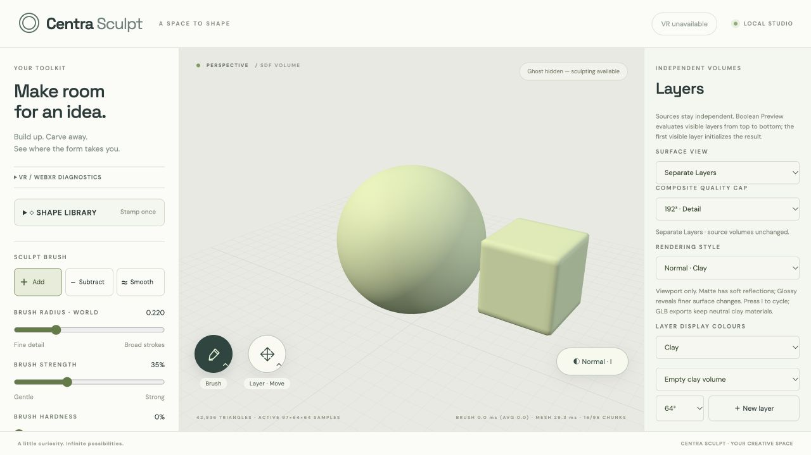

# Phase 1.15 — Expandable SDF Sculpting Volumes

Implemented 2026-10-26 in `vrappPOC`. Software integration and automated checks are complete; **physical Quest 3 acceptance remains pending**. The user-confirmed Support-trigger alternate Smooth gesture and existing controls remain unchanged. The earlier foundation-only checkpoint was extended into live editing, history, native serialization, composition and Bake after the user asked to keep going.

## Behaviour

Clay Add grows automatically before the brush's swept affected region reaches the current allocation boundary. This includes both free-space and surface-follow Add, Steady replay, Straight Line replay, large radii and motion between sparse controller samples. No surface hit is needed for free Clay. Growth considers the previous and current applicator positions plus radius; the existing interpolation kernel fills the path between them. Spare blocks prevent reallocating on every frame. Ordinary Add near the former boundary no longer shows a clipping warning.

Add stamps use the complete rotated/uniformly-scaled local AABB, grow before evaluating the command, then commit through the existing exact staged stamp path. Sphere, Box, Triangular Prism and Pyramid retain one fresh press / one action. Holding trigger never repeats. Subtract stamps, Subtract Clay and Smooth do not grow empty space. Their existing out-of-current-volume behaviour and warnings remain relevant; material can only be erased/smoothed where storage already exists.

Resource-limit failures show an error in the existing tool feedback/HUD and require the normal trigger release/repress. A failed edit does not silently resample, reduce detail, merge layers or commit a partial stroke. A failed stamp may retain newly prepared empty capacity, as described below.

## Architecture and invariants

The existing dense CPU engine remains in use. `SDFVolume` now supports rectangular allocations, using the same brush, smoothing, interpolation and meshing kernels. This is not a second VR engine or a GPU rewrite. Dense growth is a bounded first step; sparse storage remains a possible later backend.

Each layer has an immutable logical lattice:

`localCoordinate(g) = -initialExtent + g * voxelStep`

`g` is a signed integer lattice coordinate. Allocated samples have current `dimensions=[nx,ny,nz]` and `latticeMin=[gx,gy,gz]`; sample index `(i,j,k)` refers to lattice `(gx+i,gy+j,gz+k)`. The existing `resolution` property now means the **initial cubic resolution that defines spacing**, not the current allocation width. `step=2*initialExtent/(initialResolution-1)` stays unchanged. Axis-aware `coordinate(index,axis)` avoids assuming identical origins along X/Y/Z. Flat array strides use `nx` and `nx*ny`.

Growth creates a replacement with independent value/scratch buffers. Existing Float32s copy exactly, including signed zero. Negative-axis growth moves the allocation's integer minimum, not the layer, sculpture or workspace. Computing coordinates from the immutable lattice rather than accumulating floating offsets prevents drift. Every old sample stays at the exact same local coordinate. The current group/world matrices remain authoritative for tracking → workspace → sculpture → layer conversion.

New nodes use the old positive boundary extended by distance, saturated at the original field limit (`initialExtent*4`, normally 6.4). Old values are copied without clamping/resampling. New capacity is positive empty space; zero-filled arrays are never published as an expanded SDF. Previously clipped historical detail cannot be reconstructed, but future Add grows before reaching the boundary. Bounds and `worldBounds` reflect actual allocated dimensions and transformed corners.

## Growth planning and publication

`planDenseGrowth` and `prepareDenseGrowth` are shared storage helpers. `IndependentLayers` owns the live transaction coordinator, used by desktop and XR.

1. Validate a complete layer-local footprint. Add a two-sample gradient/interpolation halo and spare blocks, independently on every axis.
2. Round expanding faces to the global 16-cell lattice. Default spare margin is one 16-cell block. Other axes remain unchanged. Existing non-aligned initial last chunks are handled without changing the lattice.
3. Check dimensions, per-volume limits, the aggregate project budget (including hidden sources and retained Bake sources), and estimated storage/history/geometry peaks.
4. Allocate a new values buffer and Smooth scratch buffer, initialize only new exterior samples, and row-copy the old samples. The source stays live and untouched. Reject allocator failure or buffer aliasing.
5. Stage history index remapping and mesher layout rebinding. Past, redo and in-progress payloads are remapped before publication; existing before/after arrays remain independent and exact. Stale source copies and intervening history/mesher mutations are rejected.
6. Publish the preallocated bindings synchronously, then the runtime/layer volume reference; invalidate the derived composition cache. No asynchronous callback can interleave this publication. Target ID and layer transform remain unchanged.
7. Apply the operation through the existing brush or staged stamp command.

Copying, validation and history remapping are synchronous and non-preemptible within a frame. This is **bounded work, not a responsive cooperative scheduler**. High-resolution growth has measured stalls; see results below. The sample-gap guard tolerates time spent in the preceding owned CPU sample, so a synchronous growth pause does not by itself force cancellation on the next tracked sample. Explicit tracking/session loss still cancels.

## Meshing

The existing marching-tetrahedra extractor now reads rectangular dimensions and axis coordinates. A chunk's stable key is its signed lattice cell coordinate; numeric IDs remain stable for the lifetime of a mesher and new IDs append. A rebuilt allocation changes the lookup table, not the keys/positions of existing chunks.

Unchanged interior geometry buffers are retained. Only occupied old boundary geometry that can read a changed gradient halo is refreshed. New positive capacity has no surface, so it gets no empty mesh/geometry allocation. Subsequent edits invalidate the local cells and shared gradient halos using the new strides/origin. Tests compare complete vertices/normals against full extraction, including a fast path crossing old boundaries and repeated expansions. Geometry disposal is tested across repeated rebinding; no duplicate/orphan mesh ownership.

## Undo, Redo and cancellation

**Chosen policy: retain harmless allocated capacity.** Undo and cancellation restore voxel values and geometry, while keeping the enlarged dimensions/origin. Redo reproduces the edited Float32 field exactly within that allocation. There is no separate visible expansion action and no full empty-volume snapshot in each history entry.

Retained flat indices are remapped to the new strides/origin for past, future and active history. Consequently an old action remains correct after several negative/positive expansions; a cancelled growing stroke also preserves an existing redo chain. Growth does not clear history. Allocation metadata in a native save may therefore differ from a project that never grew, even when its occupied sculpture is identical after Undo.

History snapshot buffers are allocated before clearing the pending recorder. A snapshot allocation failure at release now rolls back instead of stranding source writes. The desktop error path also cancels rather than completing a partial stroke. In-flight recorders use a conservative per-entry estimate and a remaining edit budget; exceeding it cancels through the same exact rollback path. Reset Sphere uses that budget and rolls back if it cannot fit. Stamp preparation checks actual staged capacity, resize overlap and reserved typed history snapshots before growing its patch arrays. The source is not written until its patch and history snapshot are ready.

## Memory and configurable limits

Default hard storage ceilings are unchanged in aggregate size: **2×192³ = 14,155,776 samples per project**, at most eight layers. Rectangular allocations permit up to 512 samples on an axis while respecting that total. Hidden and retained Bake allocations count. No automatic resolution reduction.

`IndependentLayers.growthLimits` allows tighter limits through the typed application port: block size, halo, spare padding, per-growth samples, axis samples and transient-byte estimate. `DENSE_GROWTH_LIMITS` caps the configurable storage stage at 256 MiB of estimated working memory; source+replacement grids/scratch, retained histories/source geometry and remap/pending estimates also enter live preflight. Pending Map entries use a deliberately conservative 160-byte estimate, not a claimed measured cross-browser size. Stamps separately reserve typed staging/copy/history overlap.

These are safety estimates, **not a guarantee of browser process memory or recovery from a browser/OS kill**. GPU/renderer/derived CSG, engine overhead and older generations waiting for GC can add memory. Optional diagnostics label tracked memory as a lower bound. Existing retained history has a soft 32 MiB per-layer policy that preserves the latest action even if that action alone is larger. A large dense stamp can hit the staging budget despite its small visible footprint, because exact far-field CSG updates many positive samples.

| Initial spacing | Initial grid + scratch | Meaning after growth |
| --- | ---: | --- |
| 64³, h=0.050794 | 2 MiB | h stays 0.050794; dimensions can grow independently |
| 128³, h=0.025197 | 16 MiB | h stays 0.025197; no detail resampling |
| 192³, h=0.016754 | 54 MiB | h stays 0.016754; remaining dense capacity is limited |

## Native files and dependent workflows

Unexpanded cubic projects continue writing v3. Any expanded allocation writes **v4**. The reader supports v1/v2/v3/v4. V4 stores actual dimensions, initial resolution/extent, voxel spacing and signed lattice minimum, plus existing transforms/independent layer metadata and packed x-fastest Float32 LE samples. It validates origin/spacing/dimensions, aggregate counts, exact payload offsets/lengths, finite/range/positive boundaries and pathological triangle counts before publishing a project. No v4 data is disguised as v3. Existing files load at their original positions and spacing.

Undo history was not persisted before this phase and remains session-only. Expansion counters/timing are runtime diagnostics and restart after load. Expanded projects can reload, grow further and duplicate without aliasing storage.

Boolean source samplers, actual world bounds, metadata cache keys and dirty-region projection are axis-aware. Union, Difference and Intersect use full expanded extents. The derived preview remains capped at 192³ and can lose displayed detail over a large span; sources are never resampled. Bake explicitly samples a padded output at the chosen resolution with its existing detail warning, independent source retention, cancellation and timeline behaviour. Both GLB workflows include geometry outside the original cube and keep navigation/helpers out of saved project data.

**Explicit limitation:** the old cubic Resample command and deprecated v2-only writer reject expanded inputs instead of cropping them. Use an explicit Bake if a new normalized cubic source is wanted, understanding that it resamples the result and can lose detail. This does not affect v4 save/load or either export path.

## Diagnostics and validation

The optional in-headset Performance panel now includes actual dimensions/bounds, voxel/chunk counts, grid+scratch estimate, expansion count and last live expansion duration. The normal sculpting HUD remains uncluttered. Layer/shape/viewport labels show dimensions such as `113×64×64`, while the resolution selector still denotes initial spacing.

Automated checks: **506 tests pass, 0 failed/skipped** (447 prior + 33 foundation + 26 integration). Six old assertions were updated for the intentional replacement of Add clipping/rejection with growth. Tests cover six directions, exact-copy negative origins, multiple generations, no aliases, limits/fault injection, partial history rollback and snapshot allocation failure, active/past/redo remapping, full mesh/normals/reference and disposal, all shapes with rotation/scale, both-handed XR bridge growth/disconnect under tracking/workspace/layer transforms, Steady/Line, v4 roundtrip/further edits/malformed data, retained capacity, hidden aggregate budgets, CSG/Bake/GLB and complete prior regressions. TypeScript `--noEmit`, production build and whitespace check pass. Existing bundle advisory remains. Logs: `outputs/phase-1-15-{typescript,build,tests}.log`.

Benchmarks are Node CPU measurements on the recorded host, cold calls under uncontrolled load. They do not establish GPU, WebXR intervals or physical Quest performance. Scripts:

- `benchmark-dense-growth.mjs`: standalone allocation/copy/exact-source validation/rebinding, three ±X attempts at each original spacing; empty spare capacity may make an attempt a no-op.
- `benchmark-dense-growth-regression.mjs`: same unexpanded 900-sample/20-cycle workload as the preserved Phase 1.14 baseline, for comparison after generalization. No controlled speedup/regression claim from a single run.
- `benchmark-expanded-editing.mjs`: actual automatic Add path with 180 samples from -2.2 to +2.2, remesh every sixth, history and v4 roundtrip, then a rotated Box. Resource rejection is reported rather than hidden.

Unexpanded regression workload, p95 in milliseconds (before → after):

| Initial resolution | Brush | Dirty remesh | CPU batch p99 |
| --- | ---: | ---: | ---: |
| 64³ | 0.049 → 0.035 | 13.922 → 12.780 | 13.768 → 12.674 |
| 128³ | 0.111 → 0.114 | 31.094 → 28.794 | 29.724 → 28.220 |
| 192³ | 0.365 → 0.318 | 56.113 → 54.700 | 51.888 → 52.338 |

Actual growing edit workload (CPU, not XR frame intervals):

| Initial resolution | Growth count / min–max ms | Brush p99 / max ms | Remesh p95 ms | Final grid+scratch MiB | Box result |
| --- | --- | --- | ---: | ---: | --- |
| 64³ | 2 / 8.7–12.9 | 9.30 / 12.92 | 8.49 | 5.03 | 141.6 ms |
| 128³ | 3 / 55.8–78.1 | 75.67 / 78.32 | 15.13 | 28.12 | 575.6 ms |
| 192³ | 3 / 175.1–245.1 | 241.20 / 245.54 | 24.92 | 94.78 | Safely rejected: staging/history budget |

Growth timings include storage copying, retained history remapping and mesher staging/validation; they are non-preemptible. Brush samples include growth events. Brush/CPU tails use 180 samples; remesh p95 uses 30 (p99 unavailable). The 192³ Box rejection preserved source values/history; empty capacity may remain. Storage estimates exclude pending Maps, deferred GC/GPU and other caches. JSON evidence: `outputs/phase-1-15-{growth,regression,editing}-benchmark.json`. No physical headset frame-time comparison is claimed.

Browser smoke (desktop host, not Quest): fresh test tab on the existing development server. Box centred at X=2.5 grew the source from 64³ to 113×64×64; one Undo returned to 31,536 triangles with capacity retained and one Redo restored the stamp. Observed command total ~71.3 ms. A second visible boundary-crossing Box at X=1.5 produced 97×64×64 and 42,936 triangles in ~78.9 ms. Those have different source contents and are not comparable to the empty-field Node benchmark. Development reloads reset unsaved test-tab state; native persistence was validated in automated tests. Evidence: `outputs/phase-1-15-browser-evidence.txt` and image below. No physical Quest checks are marked passed.

## Quest 3 physical acceptance — all pending

Record Quest Browser version, refresh setting, initial resolution, layer count, tool/radius, diagnostics and whether a memory rejection occurred. Repeat first at 64³, then 128³/192³ as capacity permits.

1. Create/select an empty Clay layer.
2. Approach a former volume face; keep the complete brush radius visible.
3. Hold Tool trigger and draw continuously past the old face without requiring a surface hit.
4. Confirm the line extends naturally without clipping, a gap or a jump in the original geometry.
5. Draw a floating smiley beyond the original cube.
6. Extend farther in another positive/negative direction; verify all six directions across repeated strokes.
7. Draw a long Straight Line across the previous allocation edge, release and wait for replay to finish.
8. Repeat a long curved stroke at Steady 0%, 50% and 100%; inspect preview/final agreement and pauses.
9. Position a large rotated/scaled Box partly outside the old volume and press Tool trigger once.
10. Confirm the entire shape appears; repeat Sphere/Prism/Pyramid. Holding trigger must never repeat. If memory limits reject, verify a readable warning and no partial stamp.
11. Undo and redo growing strokes/stamps. Capacity may remain, but geometry and action counts must be exact. Cancel/interruption must retain redo where appropriate.
12. Move/rotate/dual-grip scale the workspace and repeat; old features must stay fixed relative to the sculpture.
13. Translate/rotate/uniformly scale a layer and repeat; other layers and saved transforms must remain independent. Check alternate Smooth/Tool-stick resizing and four-way Support shortcuts.
14. Save v4, leave/re-enter XR, reload, continue beyond another face and export both GLBs. Compare old/new geometry. Undo does not persist across reload, as before.
15. Inspect optional growth/brush/remesh/frame diagnostics during sustained drawing; record growth stalls, p95/p99/max, memory lower bound and rejection thresholds. Test tracking loss/system menu/role swap during a growing stroke, then recover with release/repress.

## Remaining limitations and Phase 2.0

Dense growth is finite. 192³ spacing consumes substantial memory for small added extents; diagonal growth may reach the project budget quickly. Large dense stamps may reject under the working-memory limit. Synchronous copying, exact validation, history remapping, staging and remeshing can pause XR frames; this phase does not solve the scheduling hotspot. Retaining capacity means Undo does not reclaim grid memory. Derived CSG/Bake quality remains bounded. Expanded cubic resampling is explicitly unavailable. Existing raw trajectory caps and lack of persisted undo remain.

Before Move/elastic deformation or new brushes, Phase 2.0 should prioritize physical Quest acceptance and measured cooperative allocation/copy/history/stamp/remesh scheduling with atomic progress/cancellation. Use real Quest peaks to tune budgets; investigate a sparse store behind the stable lattice contract if dense capacity remains impractical. Preserve v4 compatibility, independent sources and exact history through that migration. Deformation work should follow these reliability/performance gates, not replace them.
