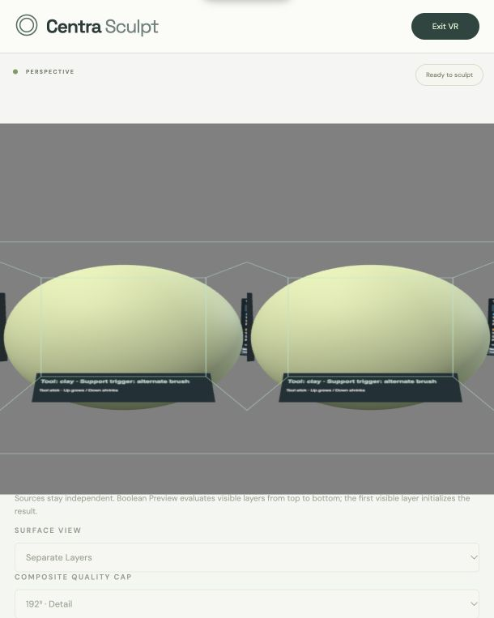

# Phase 1.14 — VR usability, reliability and performance validation

2026-10-26. Software implementation/audit complete; physical Quest acceptance and performance measurements pending. The user has physically confirmed that holding Support trigger for alternate Smooth and releasing to return to Clay feels natural. That control and the Tool-stick alternate sizing follow-up are preserved; that confirmation is not evidence of full-workflow or timing acceptance.

Validation: **447 tests pass, 0 failed/skipped**, TypeScript `--noEmit`, production build and whitespace check pass. Complete existing suites plus 14 new regressions/stress tests. Build retains the existing bundle-size advisory. Logs: `outputs/phase-1-14-{typescript,build,tests}.log`.

## Changes and audit findings

- Fixed frame-statistics omission: visible stalls ≥1 second were silently discarded. All positive finite visible intervals now enter the rolling window; backwards/duplicate timestamps are ignored. Visibility events explicitly pause the clock so system-menu time is excluded even if no hidden frames arrive. Session/rolling spike counts and median/p99 added; session start resets statistics.
- Fixed cancelled-stroke feedback: the adapter populated `message` after rollback but its feedback getter returned only placement state, so tracking/sample-budget/target-motion errors were invisible in the HUD. Cancellation reasons now appear until a new stroke or explicit interruption clears them. Exact rollback and fresh-press behaviour retained.
- Added opt-in bounded operation metrics and queue/memory observation using the existing **Performance** footer button (available inside VR even with diagnostics collapsed) and desktop checkbox. No new always-visible diagnostic panel. Disabled operation collection retains no new samples; existing baseline brush/mesher timers remain.
- Focused remesh improvement: iterate dirty IDs directly rather than copy the entire Set on every partial rebuild; maintain cumulative triangle count instead of scanning every chunk after each rebuild. New one-chunk-at-a-time regression checks exact counts/drainage. This removes bookkeeping work; no controlled end-to-end speedup claim. Marching tetrahedra extraction, synchronous history/stamp work and final drains remain the main hotspots.

## Workflow/input audit

| Workflow | Evidence and input precedence | Result / limits |
| --- | --- | --- |
| Free Clay Add/Subtract, fast continuous motion | Existing `stroke` distance subdivision and `xr-free-clay`/`free-space-clay` suites; new looping stress at all resolutions | No surface hit needed; source-local interpolation retained; centre outside bounds rolls back unfinished work |
| Steady 0/50/100 and Straight Line | Actual `ClayStrokeSession` buffered replay for two path lengths in new stress scenarios; existing endpoint/path suites | Radius frozen per stroke; preview/replay is one action; pump/final remesh can exceed nominal budget |
| Primary Smooth / alternate hold | Prior physical gesture confirmation; both-role bridge tests; new 100 rapid alternate cycles with changed temporary radii | Restores exact primary Add/Subtract/settings/path; deferred edges never split an active stroke |
| Tool-stick sizing | Existing sizing and both-handed alternate-sizing suites | Tracked Support-trigger hold exempted only for active alternate brushes; Tool trigger, replay, menus, diagnostics and every grip still block; neutral rearm after transitions |
| Stamps and wrist rotation | Existing all-shape, wrist/transform, held-trigger, bounds, exact-history tests; four rotated stamp commands per stress run | One fresh Tool press/commit; Add atomic bounds rejection, Subtract affects in-volume material; no haptic per voxel |
| Tool Wheel / Options / Layers | Existing real menu pointer, held-trigger and confirmation tests | Support stick reserves menus; Tool trigger belongs to menu; grips dismiss and require release/repress; menu requests during a stroke remain blocked |
| Selection / independent transforms | Existing transformed/hidden/locked/overlap selection and layer-grab suites | Tool trigger selects only in Transform; Tool grip transforms only there; interruptions roll back metadata, no SDF resampling |
| Undo/Redo | Existing project-history shortcut suites; new repeated exact round trips at all resolutions | Support Left/Right preserved; busy edit guards prevent implicit completion; latest-action soft history budget remains |
| Workspace / two-hand navigation | Existing physical-role/reversed-slot grip transition, collapse/rebase and save/export-isolation suites | Support grip workspace; both grips rotate/scale; metadata/project voxels unchanged |
| Left/right hand, tracking, visibility, entry/exit | Existing bridge/session suites plus prior both-handed alternate/sizing regressions; browser emulator entry/exit | Physical role is independent of connection slot; input holds require release after interruption |
| Layers, locks and hidden sources | New stress edit rejection; existing source isolation/Bake/layer history tests | Independent arrays/transforms/history retained; hidden sources count toward memory budget |
| Boolean composition | New overlapping transformed Difference at 64³, existing Union/Difference/Intersect suites | Read-only source samplers; derived 192³ quality cap can limit preview detail |
| Explicit Bake | Complete existing Bake suite: cancellation, exact timeline replay, source retention, capacity and export | Current VR palettes expose composition view; explicit Bake command remains desktop workflow after leaving VR |
| Native save/load and GLB | New native Float32 roundtrip + separate mesh export at all resolutions; derived export at 64³; existing both binary GLB and native validation suites | Current save/load/export controls are intentionally disabled during XR; exit first. No schema or export-root change |
| Haptics | Existing same-source cooldown/pending, missing/false/throw/rejection tests | Best effort; 80 ms cooldown, no delayed queue; physical strength/support still needs Quest verification |
| Sustained sessions / resource bounds | New synthetic 91-second Tool hold, 8193 samples; 20 repeated cancel/undo cycles per benchmark resolution | Sample cap cancels with exact voxel rollback and visible reason. This is simulated time, not a physical long-run endurance test |

No new VR Bake/save/load/export menus were introduced. That is a current workflow limitation, not a claim that these actions were tested through headset menus. No input scheme replacement or geometry/storage migration.

## Diagnostics and methodology

Toggle **Performance** on the existing right-side diagnostics card in VR, or **Show VR performance** before entry. The optional performance card stays to the left, away from the sculpting centre. Its placement is unchanged; canvas aspect grows to fit the added lines. Refresh at most twice a second, reuse texture/geometry. Collection uses fixed 240-sample rings for brush, remesh, path filtering and completed stroke operations; no unbounded timing logs. XR frame intervals use the existing 120-sample window. Nearest-rank p95 requires 20 samples, p99 requires 100; unavailable tails/heap display `n/a`.

- **Brush:** existing transaction/path kernel plus dirty invalidation time per sampled application, not a single voxel's cost.
- **Remesh:** dirty-chunk extraction plus publication to the source surface, only when chunks actually rebuild. Latest duration remains visible while idle.
- **Component stroke CPU:** sum of brush, intermediate/final source remesh, path filter/replay preparation and finish/cancel transaction overhead. Excludes user hold duration and rendering.
- **XR stroke CPU:** accumulated whole `XRClayStroke.update` callbacks from start through release/replay/end, including pose conversion, preview publication and component work. No wall-clock dwell or GPU timing. External interruption callbacks are outside this update measurement. Enabling collection midway through a stroke does not claim a complete XR stroke measurement.
- **Queue:** source dirty chunk count across installed layers, plus remaining buffered replay dabs. Stamps are synchronous, not an asynchronous queue; zero after a command does not mean the command was cheap.
- **Memory:** tracked lower bound for installed source grid+Smooth scratch, retained typed history and source geometry; sampled high-water mark. Excludes pending history Maps, staging/copy peaks, retired Bake payloads, composite, renderer/GPU and JS overhead. Optional browser `performance.memory` heap/peak displayed only if available. Neither number is a Quest process-memory measurement; sub-500 ms peaks can be missed.
- **Frame:** estimated FPS, median/p95/p99/max and latest positive visible interval, session and last-120-frame spikes relative to the rolling baseline. Callback CPU/input time is not GPU time. A long visible stall is retained; explicit hidden time is excluded.

The benchmark executes real CPU kernels/transactions, 900 moving samples at simulated 90 Hz (10 synthetic seconds) with a remesh every nine samples, .5 maximum-radius Add/Subtract/Smooth, Steady 0/50/100 or Line at .2/1.6-unit lengths, four rotated alternating stamps, 20 exact cancel/undo/redo cycles, transformed save/load/export; 64³ also overlaps a transformed Difference layer and exports its derived composition. Tests run a smaller 180-sample/4-cycle variant. No machine-dependent time thresholds are used as correctness assertions.

Run `npm test`, then `node scripts/benchmark-vr-validation.mjs`. Report records Node version/platform/architecture and includes cold calls. Assert/save/import overhead contributes to total wall time. Workload timing samples are **CPU processing batches, not headset frame times**. Node and browser observations must never be combined into a claimed Quest FPS.

Final Node results (milliseconds; p95/p99 unavailable when under the stated sample minimum):

| Resolution | Brush median / p95 / p99 / max | Remesh median / p95 / p99 / max | CPU batch median / p95 / p99 / max | Replay max | Stamp max |
| --- | --- | --- | --- | ---: | ---: |
| 64³ | 0.015 / 0.049 / 0.123 / 0.407 | 10.963 / 13.922 / 14.760 / 19.465 | 0.016 / 11.220 / 13.768 / 19.488 | 13.165 | 70.086 |
| 128³ | 0.072 / 0.111 / 0.177 / 0.387 | 21.272 / 31.094 / 34.138 / 55.898 | 0.075 / 22.261 / 29.724 / 55.976 | 28.425 | 386.621 |
| 192³ | 0.208 / 0.365 / 0.497 / 0.719 | 37.513 / 56.113 / 59.317 / 62.023 | 0.214 / 40.263 / 51.888 / 62.277 | 68.329 | 1151.379 |

Brush and CPU batches: 900 samples each; remesh: 100. Replay: 26–35 pumps (no p99). Stamp: 4 commands per resolution (no percentile claim). Source+scratch are 2/16/54 MiB; final tracked lower bounds ~9.67/46.25/66.54 MiB include source geometry/history (64³ includes the second overlapping layer). Results: `outputs/phase-1-14-stress-benchmark.json`; no physical Quest timing.

The final remesh bookkeeping change was measured in a separate run under uncontrolled host load. Earlier run remesh p95 was 12.21/28.43/53.64 ms; the final run differs. This is not a controlled before/after speedup study. The optimization does not resolve extraction/history stalls.

## Browser observation (emulator, not hardware)

Existing user server `http://localhost:5173/?xrEmulate=quest3`, existing IWER development emulator. Enable Performance, enter XR, observe tracked sources with realistic `meta-quest-touch-plus` models, optional metrics and active tool/radius, then exit: desktop controls restored and 0 Undo/Redo. The observed idle rolling window was approximately 120 estimated FPS, median 8.3 ms, p99 9.7 ms; these describe the host/emulator's idle scheduling only. No controller-driven browser stress or physical headset timing claim. UI evidence: `outputs/phase-1-14-browser-evidence.txt`, stereo image below. The narrow stereo mirror crops peripheral cards; full headset readability remains pending.

## Physical Quest 3 acceptance checklist — pending

Record headset/browser version, refresh configuration, date, resolution, layer count, tool/radius, elapsed session, interval median/p95/p99/max and spikes. Capture CPU/queue/memory while Performance is enabled, then compare feel with it disabled. Only the alternate hold gesture has prior user confirmation.

1. **Free Clay:** create an empty layer, Add a floating smiley/disconnected marks, Subtract and Smooth; no unintended source changes. Repeat in Separate Layers and after transformed selection.
2. **Fast continuous:** slow/fast loops and abrupt turns at each resolution; inspect gaps and trigger-release endpoints. Undo one action restores exact prior state.
3. **Straight Line:** short and long 3D segments, pause while held, release and wait for applying-preview to finish; one action, no extra endpoint blobs.
4. **Steady:** 0%, 50%, 100%; compare jitter/lag and preview/final agreement. Test longer strokes and queue drainage. Existing cap should explain rollback rather than leave partial history.
5. **Alternate Smooth:** retain the physically confirmed hold/release gesture; press/release Support during Clay and Smooth strokes, including replay. Primary operation and all settings restore. Repeat rapid alternation.
6. **Stamps:** all shapes, Add/Subtract, wrist rotations and offsets; one command per fresh press, held trigger never repeats, bounds rejection leaves Undo/Redo intact. Test repeated large stamps and record full command pause.
7. **Sizing:** Tool stick Up/Down at idle and while holding alternate; centre to rearm. Primary radius restores on Support release. Tool trigger/stroke, menu and grips block sizing; preview follows next idle size.
8. **Menus:** all four Support shortcuts, Options pages/slider, Layers hide/lock/select, disabled items. Attempt opening during active stroke and holding trigger through close; no accidental sculpt/stamp/grab.
9. **Selection/transform:** direct nearest source, overlapping/empty/hidden/locked fallback, saved Tool-grip move/wrist rotation, reset confirmation; source voxels unchanged, Undo/Redo exact. Both handedness settings and reversed reconnect order.
10. **Workspace:** Support grab, Tool join, two-hand rotation/scaling, release either hand and regrip; no jumps or project-scale edits. Near-collapsed hands recover safely.
11. **History and hybrid commands:** rapid Undo/Redo including stamps/layer transforms, busy guards; exit XR to Bake visible overlapping Boolean layers and save/load/export both GLB paths, then re-enter with sources intact.
12. **Sustained performance:** 10–20 real minutes at 64/128/192 as memory allows; multiple layers, max brush, long Steady/Line and repeated stamps. Track thermal/frame/memory changes, remesh pauses and responsiveness. A synthetic 10-second/91-second workload is not this test.
13. **Finite boundaries:** approach each face with max radius, watch amber clipping warning; centre crossing cancels the unfinished stroke. Add stamp crossing safe margin rejects; Subtract affects only inside. No automatic expansion/detail loss.
14. **Recovery:** obscure each controller, disconnect/reconnect, change dominant hand, open system menu, exit while holding trigger/grips/replay, re-enter; exact rollback/committed history and primary settings preserved, held inputs cannot restart. Check haptic throttling/fallback and normal sculpting with diagnostics off.

## Known limitations / follow-up

Synchronous remesh/final drain, non-preemptible replay dabs and dense staged stamp/history work remain; first 192³ stamp can exceed one second on this host. Expanded instrumentation now exposes these stalls. Fixed positive-boundary volumes, capped derived CSG and retained latest-action soft history limit remain. Long raw trajectories cap at 8192 samples (~91 s at 90 Hz, ~68 s at 120 Hz). Physical Quest/GPU/heap peak/thermal and haptic feel remain unverified. Existing production bundle advisory persists. No expansion or new tools implemented.

Next: [Phase 1.15 architecture and acceptance plan](PHASE_1_15_EXPANDABLE_VOLUMES.md), starting with stable lattice coordinates and history identities; in parallel scheduling, isolate cooperative stamp/remesh work as a separate measured change with atomic cancellation/progress. Do not hide those stalls by discarding long intervals or by silently resampling layers.
